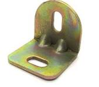
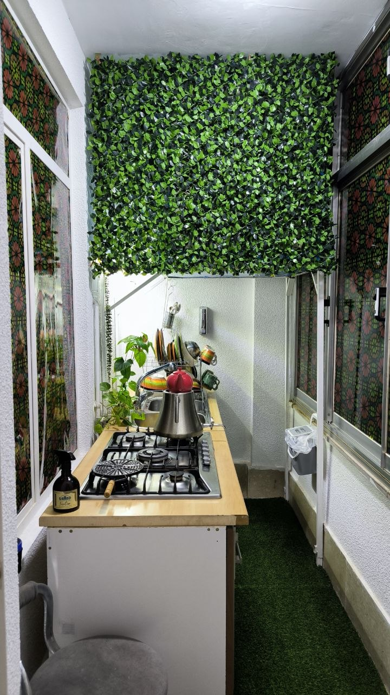

در صورتی که کولر شما در بالکن قرار دارد برای پنهان سازی آن می‌توانید بصورت زیر عمل کنید.  
اول از همه برای افزایش فضا می‌توانید کل کولر را بر روی چهارپایه فلزی مانند عکس قرار دهید تا بتوانید از فضا زیر آن استفاده کنید.  
سپس برای پوشاندن آن می‌توانید از `گرین وال مصنوعی` استفاده کنید.  
برای شروع کافی است چند عدد `گونیا 90 درجه` به دیوار پیچ کنید و سپس گرین وال را با پیچ مهره و یا طناب به آن محکم کنید.  

  

خروجی کار بصورت زیر خواهد شد:  

  